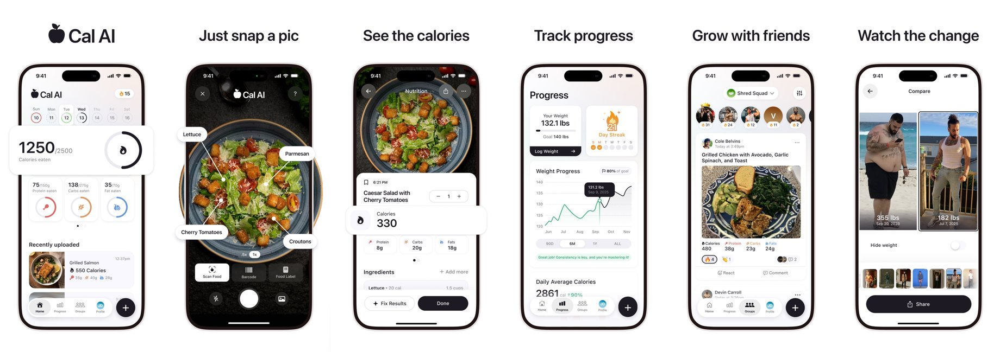
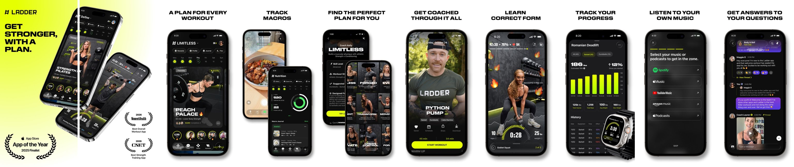
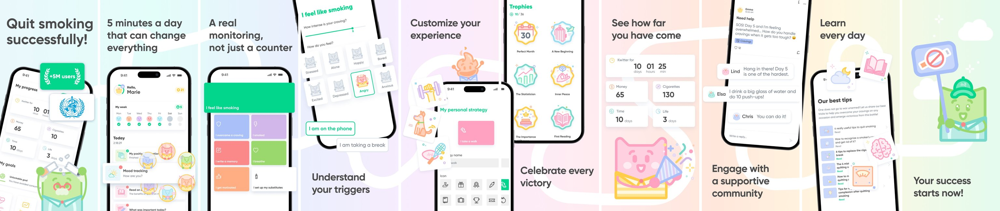
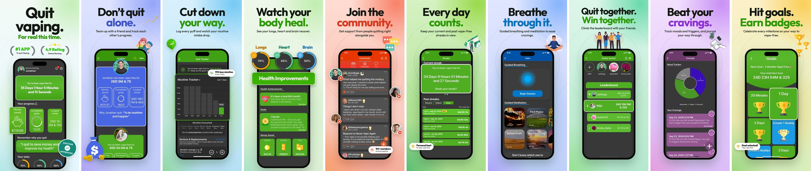

# Win the first three DayXero screenshots

Market leaders in Health & Fitness and in quitting all follow one formula. Captions are 2–6 words at the top of the frame. Every frame shares one background system. Each frame shows one benefit in a modern iPhone frame, and frames 1–3 work as a complete pitch on their own, because a search result shows only those three portrait screenshots when no preview video exists ([Apple](https://developer.apple.com/app-store/product-page/)). Quit apps add a fixed set of table stakes on top: a live counter appears in slot 1 or 2 in 9 of 11 sets, money saved in all 11, then health recovery, badges and a craving tool. Most also pile unsourced "#1" or "Doctor Approved" trust marks onto slot 1. No top quit app shows a prep-to-Quit-Day timeline. None says in a caption that a slip keeps your days. None sells cigarettes, vapes and pouches together. Kwit has just taken the "5 minutes a day" angle, so DayXero should present its ~3-minute sessions as part of the 7-day prep mechanic, not as its headline. Apple's rules shape the plan too. Screenshots cannot show prices or the word "free", cannot make unverifiable claims, and must suit a 4+ audience. The upload is 10 frames at 1320 × 2868, plus a 1206 × 2622 copy for the required medium class. The best conversion evidence is old and mostly from vendors, but it agrees on one point: few people scroll far. The recommended DayXero set therefore puts its unique message in slots 1–4. The order is promise and products, then the prep arc, Craving SOS, and slips never reset. Depth fills slots 5–10, and the set closes on the Day 30 "clear sky". Proof is added only once it is real. Product Page Optimization should then test the order.

The reference library sits at `/home/user/DAYXERO/reference/app-store-screenshots/`. It has `health-fitness/{slug}/` (20 apps) and `quit/{slug}/` (11 apps). Each folder holds the current product-page frames `01.jpg…`, a one-image contact sheet `_sheet.jpg`, `app.json` metadata and, where the set changed, the older set in `api-lookup-set/`. The full index is in the appendix.

## Leaders spend frames 1–3 on claim, mechanic and payoff

The 20 Health & Fitness apps are not a pure download top 20. On the 19 Nov 2026 US Top Free chart, 8 sit in the top 20: Flo #2, Planet Fitness #3, Oura #4, Strava #6, Ladder #7, Yuka #12, Cal AI #15 and MyFitnessPal #16. The rest are revenue heavyweights. MyFitnessPal is #1 grossing, Calm #5 and WeightWatchers #24. Noom, Sleep Cycle and WW are absent from the top 100 free ([Apple RSS, top free](https://itunes.apple.com/us/rss/topfreeapplications/limit=200/genre=6013/json); [Apple RSS, top grossing](https://itunes.apple.com/us/rss/topgrossingapplications/limit=200/genre=6013/json)). Headspace and Peloton were swapped for Oura and Stardust because neither appears in the top 100 free. Treat the group as "the category's biggest brands" rather than a strict download ranking.

The formula across these sets is very consistent. All 20 are portrait. **Half use the full 10 frames.** The average is about 8.6, and Calm, Cal AI, BetterMe and Yuka ship only 6. Captions sit at the top in nearly every set, usually 2–5 words, at a cap height of about 3–4% of frame height. Frame 1 often doubles that to 8–12% so it reads at thumbnail size: MyFitnessPal, Planet Fitness, Nike Run Club and Stardust all do this. Every set holds one background treatment. The only breaks are deliberate hero or closer frames, such as Ladder's neon 1–2 or Noom's photo closer. Only **2 of 20 lead with an App Preview video** (Planet Fitness, Strava). Only Planet Fitness shows its paid tier, and it puts it last ([Planet Fitness](https://apps.apple.com/us/app/id399857015); [Strava](https://apps.apple.com/us/app/id426826309)).

Slot 1 follows one of three openings:
- **Proof.** 8 of 20 put proof on slot 1. MyFitnessPal and Calm use "#1" claims. Lose It! adds "#1 Weight Loss Tracker" to five press logos. Ladder shows an "App Store App of the Year 2025 Finalist" laurel and puts two 2026 awards on slot 2. Strava uses its Apple Watch award, Stardust "2 million monthly users" and AllTrails "500,000+ trails" ([Ladder](https://apps.apple.com/us/app/id1502936453); [Lose It!](https://apps.apple.com/us/app/id297368629); [Calm](https://apps.apple.com/us/app/id571800810)).
- **Brand attitude.** Nike Run Club opens on "LEAVE YOURSELF IN THE DUST" and Planet Fitness on "PROGRESS STARTS HERE".
- **Product.** Flo, Oura, Fitbit and Cal AI lead with UI under a plain benefit line.

The product-first sets that pair UI with no hook, Oura and Fitbit, read as feature lists. **Cal AI is the clearest model for an unknown brand.** Its frames 1–3 are logo plus calorie ring, "Just snap a pic", then "See the calories". That is a complete how-it-works loop in about nine words, and the set closes on a before/after transformation ([Cal AI](https://apps.apple.com/us/app/id6480417616)). **Noom is the best behaviour-change template.** It shows the mechanism ("psychology") on slot 1. Slot 2 is a personal, dated prediction ("We predict you'll be 150 lbs by May 8"), and slot 3 a daily plan ([Noom](https://apps.apple.com/us/app/id634598719)).

Other moves recur:
- **Panoramas.** About 9 of 20 sets join frames into a panorama or continuous background. Sleep Cycle, Hevy and Ladder leave slot 2 uncaptioned, so the search triad becomes one billboard plus a single feature frame.
- **Trust closers.** Flo closes on Anonymous Mode and a named MD. Yuka closes on independence. AllTrails closes on a press quote.
- **Medication.** One shift came out of the product-page refresh. The two legacy diet programs now sell GLP-1 access: WW from slot 1 and Noom on slots 6–7, with the subtitle "Healthy Habits, Meals & GLP-1s" ([WW](https://apps.apple.com/us/app/id331308914)). That is the weight-loss equivalent of a quit app showing NRT openly.
- **Phone surfaces.** Almost nobody shows them. Widgets appear only in Nike Run Club's frame 9. **No set shows a Live Activity.** The Apple Watch appears only in Strava, Nike Run Club and Ladder.

### The Lookup API shows stale sets, so benchmark the product page

The iTunes Lookup API is a methodological trap. When the group B and quit sets were re-fetched from the product page, **10 of 21 apps showed different files** from what `/lookup` returned. Six were entirely new creative sets: Noom, WeightWatchers, Quit Vaping, Kwit and Sober Sidekick, plus a revised Ladder. Hevy had refreshed UI under the same captions. Three were simply re-rendered at 6.5". Developers who refreshed only their largest device class left a stale 5.5" set behind in the API ([Noom](https://apps.apple.com/us/app/id634598719); [Kwit](https://apps.apple.com/us/app/id525441365)). Group A was captured from the product page from the start, so its analysis already reflects current sets. Any statement here about Quit Vaping, Kwit, Sober Sidekick, Noom, WW, Hevy or Ladder reflects the current set. The older sets remain in each `api-lookup-set/` folder and make useful before/after studies. Each page was fetched once, so Product Page Optimization variants or Custom Product Pages could show other visitors something else.

## Quit apps share a counter formula and leave three gaps open

The quit top 10 is ranked by US lifetime rating count, because no public download estimates exist for the niche. **Seven are nicotine apps:** Smoke Free (57,288 ratings), QuitNow (13,644), Quit Vaping (11,680), Kwit (2,837), Puff Count (2,687), QuitSure (1,590) and EasyQuit (1,155). **Three are category-setting sobriety apps:** I Am Sober (191,610), Reframe (45,738) and Sober Sidekick (8,136). Exhale is a fast-growing bonus: 313 ratings in about 8.5 months ([Smoke Free](https://apps.apple.com/us/app/id577767592); [Exhale](https://apps.apple.com/us/app/id6756926563)). Rating count favours old apps, so confidence is high for the top four nicotine apps and medium for the rest. **No pouch app has scale.** The biggest, Snusless, has 21 US ratings ([Snusless](https://apps.apple.com/us/app/id6740810702)). QUITTR currently returns no US lookup result.

The category formula is a 2–8 word headline over a framed UI screen. A live counter appears in slot 1 or 2 in **9 of 11** sets, often down to the second. Money saved appears in **11 of 11**, health recovery rings or timelines in 5, badges in 7, community in 8 and a craving tool in 7. Seven of 11 still use saturated blue or purple gradients. Slot 1 is where the sets differ:
- **Trust marks.** Smoke Free claims "Eight million downloads worldwide". Quit Vaping's new set carries "#1 APP To quit Vaping", "4.9 Rating – Global Ranking" and an unnamed "DOCTOR APPROVED" seal. Kwit shows "+5M users" next to the WHO emblem.
- **Authority badges.** QuitNow uses WHO plus App of the Day. Reframe uses press logos plus an award.
- **Questions.** Puff Count asks "Ready to QUIT?" and is now the only set using that line. QuitSure asks "Addicted to smoking?"
- **Counter or scope.** I Am Sober, EasyQuit, Sober Sidekick and Exhale open on the counter or the app's scope.

Smoke Free and QuitNow play an App Preview video before slot 1 ([Quit Vaping](https://apps.apple.com/us/app/id1479615245); [QuitNow](https://apps.apple.com/us/app/id483994930); [Puff Count](https://apps.apple.com/us/app/id1488580640)).

Evidence claims range widely. Four sets make none. **QuitSure** makes the strongest claims: "81% quit completely*", footnoted to a UCSF study that could not be found, now repeated in its subtitle "Clinically proven. 81% success", plus "No withdrawal symptoms" and "No weight gain" ([QuitSure](https://apps.apple.com/us/app/id1523992725)). **Reframe** stacks press, university logos and self-reported "91% … substantial decrease" figures ([Reframe](https://apps.apple.com/us/app/id1485756576)). **None of the 11 cites FDA, NHS, CDC or a named trial**, and the refresh spread unsourced trust marks further. Laurels have become wallpaper in this category, so they no longer set anyone apart. Localisation slips persist: Smoke Free shows £ on the US page, and EasyQuit and Exhale show €.

**Kwit is now DayXero's closest competitor set.** Its slot 2 reads "5 minutes a day that can change everything", and its slot 3 reads "A real monitoring, not just a counter" over an action grid. That grid lists "I smoked" as an ordinary entry next to "I overcame a craving" ([Kwit](https://apps.apple.com/us/app/id525441365)). **Quit Vaping is the craft benchmark for a vape-first audience:**
- Two-tone headlines in two short lines ("Cut down your way.", "Watch your body heal.")
- A grey subhead and one floating proof chip per frame
- Current Dynamic Island frames
- A nicotine taper log where a "Nicotine Lozenge 4mg" entry does not stop the "vape free" counter

Yet its slot 6 still asks "Break your streak?", the reset model DayXero rejects. Exhale is closest in spirit, with a red panic button in the tab bar, an "I relapsed" quick action and "Not quite" check-in copy. It ships only five generic headlines.

After the refresh, four openings remain for DayXero:
- **The prep-to-Quit-Day arc.** QuitSure has a six-day program but never draws it as a timeline. Puff Count's "Day 12 of 54" card is the nearest thing.
- **A caption saying a slip keeps your days.** Kwit and Quit Vaping imply it in the UI, but nobody says it.
- **Cigarettes, vapes and pouches in one app.** QuitSure's title says "Smoking & Vaping" but its screenshots show only cigarettes.
- **Craving SOS in the first three frames.** Kwit's craving flow sits on slots 3–4, Quit Vaping's "Breathe through it" on slot 7, and Exhale names its panic button only in slot 5's list.

Widgets (EasyQuit only) and Live Activities (nobody) are open across both categories. The "about 3 minutes a day" message is no longer unique, so it should support the prep mechanic rather than lead.

## Apple's specs and rules strip out price, "free" and unproven claims

Apple accepts **1–10 screenshots per device size**, in .jpeg, .jpg or .png, with **no alpha channel or transparency** ([Apple, screenshot specifications](https://developer.apple.com/help/app-store-connect/reference/app-information/screenshot-specifications/)). Apple's page now names device classes, not inch sizes, and it is internally inconsistent. Its "Required device sizes" line names the **iPhone with Dynamic Island (medium display)** class, at 1206 × 2622 or 1179 × 2556. Its Face ID row treats the **large display** class, at 1320 × 2868, 1290 × 2796 or 1260 × 2736, as primary. The two ratios are effectively identical (0.4603 and 0.4600), so the safe approach is to design once at **1320 × 2868**, export a 1206 × 2622 copy and upload both. Apple scales down to smaller classes automatically. It sets no colour-space or DPI rule, so flattened 8-bit sRGB PNG is a sensible default, though that is not an Apple requirement. Two classes come later or only if they apply. **iPhone Duo** screenshots (1398 × 2034 outer, 2007 × 2853 inner) become mandatory from April 2027 for apps built with the iOS 27.1 SDK or later. iPad screenshots (2064 × 2752) are needed only if DayXero runs on iPad. App Preview videos run 15–30 s at 886 × 1920, up to three per size ([Apple, app preview specifications](https://developer.apple.com/help/app-store-connect/reference/app-information/app-preview-specifications/)). Real leaders do not always upload the largest class: Noom's largest set is 6.3".

These App Review rules bind DayXero's creative ([App Review Guidelines](https://developer.apple.com/app-store/review/guidelines/)):

| Rule | What it says | What it means for DayXero |
|---|---|---|
| 2.3.3 | Show "the app in use", not just title art or splash screens. Text overlays are allowed | Every frame shows real UI. Character art supports the UI and does not replace it |
| 2.3.7 / 2.3.14 | No prices, no terms that don't fit the metadata type, and no "unverifiable product claims" | No "Free", "$39.99", "trial", "Quit in 7 days", "clinically proven" or "% quit". In-app stats such as "$412 kept" are fine |
| 2.3.2 | Indicate whether featured items need an extra purchase | Prep week, Day Xero, counter and SOS are free. Mark any Week 1–4 session screen with a small "DayXero Pro" tag |
| 2.3.8 / 1.4.3 | Screenshots must suit a 4+ audience. Apps may not encourage tobacco or vape use | Show products only as neutral icons in a picker or as "not used" tiles. Never show an appealing vape or cigarette |
| 1.4.1 | Medical apps get "greater scrutiny" and must disclose methodology behind accuracy claims | Health-recovery frames cite sources in the UI and avoid numeric efficacy |
| 5.2.4 / Section 3 | Don't imply Apple endorsement. No manipulated ratings | No fake "Editor's Choice" or "App of the Day" laurels. Show ratings only when real |

Google Play is a separate build. It takes **2–8 phone screenshots** with an aspect ratio no more extreme than 2:1, recommended at 1080 × 1920, plus a required 1024 × 500 feature graphic ([Adalo](https://studio.adalo.com/blog/google-play-screenshot-sizes); [AppStills](https://www.appstills.com/guides/google-play-screenshot-sizes)). At about 1:2.17, **the iOS files exceed Play's limit** and must be re-composed at 9:16. Secondary sources summarise Play's metadata policy as banning ranking claims ("#1", "best"), accolades, price or promo text, and calls to action such as "Download now" in listing graphics ([AppSubmitter](https://www.appsubmitter.io/app-rejection-guides/google-play-metadata-policy/)). The official Play Console pages could not be fetched, so verify there before any Android launch. The iOS-specific frames (Live Activity, Lock Screen) would be the ones to drop.

## Conversion evidence says few scroll, and little else is firm

The most cited scroll-depth figure is SplitMetrics' 2018 analysis of about 1,800 tests. It found **only 11% of users see all five portrait screenshots** (15% for landscape) ([SplitMetrics](https://splitmetrics.com/blog/apple-screenshots-scroll-depth/)). SplitMetrics' 2024 finance benchmark puts the share reaching the fifth screenshot at about 7% ([SplitMetrics 2024](https://splitmetrics.com/aso-benchmarks-2024/2-3-finance-apps-screenshot-trends)). Both predate today's 10-frame Dynamic Island layouts, and neither covers Health & Fitness. The popular "70% never scroll past the first screenshot" figure traces to no study ([picc](https://explore.picc.co/app-store-screenshots-costing-downloads/)). Apple's own guidance carries the same priority: make the first one to three images "highlight the essence of your app", then give one benefit per screenshot, and include a Dark Mode shot if the app supports it ([Apple, product page](https://developer.apple.com/app-store/product-page/)).

Effect sizes beyond that are weak:
- **Captions and redesigns.** Shorter captions and bolder graphics gave SongPop2 about 10% more conversion ([SplitMetrics](https://splitmetrics.com/?p=4944)). Screenshot redesigns lifted OLBG by 61% and ZiMAD by 32% ([OLBG](https://splitmetrics.com/cases/olbg-ios-screenshots-optimization/)). These are older single-app cases.
- **Benefit-led captions.** One vendor claims an **18–31%** lift from benefit-led captions across four tests, with no sample sizes ([Sonar](https://trysonar.app/blog/app-store-screenshot-captions)).
- **Video cuts both ways.** Vendors report +16% to +35% lifts, but a StoreMaven finance test lost 3–7% ([appboard](https://appboard.dev/blog/app-preview-video-vs-screenshots)). Apple's own PPO example says the page without a video "outperformed the treatment, contrary to the developer's hypothesis" ([Apple, PPO](https://developer.apple.com/app-store/product-page-optimization/)).
- **Captions as a ranking signal.** Whether screenshot captions now affect search ranking is disputed. ConsultMyApp tested 64 caption phrases across 8 leading US apps. 36 did not rank, 27 were explained by existing metadata, and 1 anomaly remained ([ConsultMyApp](https://consultmyapp.squarespace.com/blog/-is-apple-now-indexing-screenshot-titles-on-the-app-store)). Writing captions in search vocabulary ("quit vaping", "cravings", "nicotine pouches") costs nothing. It should not replace the title, subtitle and keyword field.
- **Category data.** No quit-category screenshot test was found. Health & Fitness page conversion benchmarks run from an 18.5% median (SplitMetrics) to 30.8% (AppTweak panel), and their methods differ ([SplitMetrics](https://splitmetrics.com/blog/whats-a-good-app-store-page-conversion-rate/)).

Two Apple tools turn these open questions into experiments:
- **Custom Product Pages.** Up to 70 extra pages, each with its own screenshots, can now be assigned keywords and appear in organic search. Apple reports +2.5 percentage points average conversion when traffic goes to a tailored page ([Apple, custom product pages](https://developer.apple.com/app-store/custom-product-pages/)). Keywords already in the title or subtitle cannot be assigned to a CPP ([AppTweak](https://www.apptweak.com/en/aso-tools/custom-product-pages-cpp?lang=en-US)).
- **Product Page Optimization.** It runs up to three treatments for up to 90 days. Apple recommends waiting for 90% confidence ([Apple, PPO](https://developer.apple.com/app-store/product-page-optimization/)).

Every rule in the plan below is a hypothesis that PPO can settle with DayXero's own traffic.

## DayXero's 10 frames: lead with the method, not the laurels

The plan follows four principles drawn from the benchmark.

First, **frames 1–3 must sell DayXero alone**, because few users see more:
- Frame 1: the promise plus the three products.
- Frame 2: the prep → Quit Day mechanic, which nobody else shows.
- Frame 3: Craving SOS, the free-forever, most-felt feature.

This is Cal AI's claim → mechanic → payoff loop, applied to quitting. Frame 4 carries the slip rule, the most original message in the category. It should be PPO-tested in slot 3.

Second, **no tilted-phone panorama across 1→2.** The quit category overuses it (QuitSure, I Am Sober, Reframe, Sober Sidekick), and an uncaptioned slot 2 wastes a search frame. Continuity comes from the "clearing sky" instead. Each frame takes its character's ground colour (Xero apricot #FFC38A, Jelli ocean #2A52DB, Glim violet #4A3596), and the haze lifts from frame 1 to frame 10. Kwit's path ribbon and Sleep Cycle's continuous sky show this kind of continuity can carry a set. The type system stays fixed throughout:
- A heavy two-line headline of six words or fewer, with the second line or key phrase in an accent colour, as in Quit Vaping.
- One sentence-case subline.
- Current Dynamic Island frames.
- One floating UI chip per frame.

Third, **use honest proof only.** At launch DayXero has no ratings, awards or outcome data. It should not imitate "#1 APP", "Doctor Approved" or "81% quit", which carry 2.3.7/2.3.14 risk and are already wallpaper. Mechanism detail stands in for proof: what happens on each prep day, what the app does after a slip. Once real, a star rating with its count goes on frame 1, the way Hevy uses its "Apps We Love" laurel, and a named clinical advisor credit goes on the health frame.

Fourth, **follow the design system's seriousness tiers.** The slip, health and NRT frames sit on a quiet cream or navy surface with a small character or none. That answers the risk the design system itself flags: older, heavy smokers may read cartoons as "not for me" ([design system](../design/handoff/DAYXERO_DESIGN_SYSTEM.md)).

| # | Job | Headline (accent in **bold**) | Subline | What the screen shows | Ground and character | Pattern borrowed from |
|---|---|---|---|---|---|---|
| 1 | Promise, scope, hero counter | Quit nicotine. **Prepared, not pressured.** | Cigarettes · Vapes · Pouches | Home hero: Xero rising, "Day 12 clear", "$118 kept", tiles "not smoked / puffs not taken / pouches not used". Caption at about 8–10% cap height for thumbnail legibility | Apricot dawn, Xero | Quit Vaping slot 1 (promise over a live home), Lose It!/MFP oversized frame-1 type |
| 2 | The unique mechanic | 7 days to get ready. **Then Quit Day.** | About 3 minutes a day, one small step each | Program timeline: Prep 1–7 ticked to today → Day Xero (the Quit Day session) → Week 1–4. Floating chip: "Quit Day: Friday" | Apricot, Xero small | Noom slot 2 (a personal, dated plan), Puff Count's "Day 12 of 54" card |
| 3 | Craving SOS | Craving hits? **Ride the wave.** | Tap SOS and breathe with Jelli: 4 in, 6 out | SOS screen: Jelli pulsing, ridden time counting up, "It passed" / "I slipped". Chip: "Xero passed you to Jelli" | Ocean, Jelli | Exhale's always-on panic button, promoted from slot 5 to slot 3 |
| 4 | Slips never reset | A slip **never resets your days.** | Log it, spot the trigger, make one plan | Slip talk-through: "Still Day 12 clear", trigger chip "Coffee", "Then I'll take a short walk" saved as a plan | Quiet cream/navy surface, Jelli at 88 px | Kwit's neutral "I smoked" log, now stated as a caption |
| 5 | Daily session | 3 minutes a day. **That's the work.** | Short lessons and a plan for hard days | A session beat, e.g. "If today gets hard, then I will…" with "Walk for 5 minutes", "Open Craving SOS". If it is a Week 1+ session, add a small "DayXero Pro" tag (2.3.2) | Apricot, Xero | Kwit slot 2, Reframe's daily tasks |
| 6 | Progress and money | Every clear day **adds up.** | Days clear, money kept, nicotine skipped | Progress: days-clear count, dollars kept in **USD**, product-specific tiles, ridden-out cravings count | Apricot to clear sky | Category table stakes (money 11/11), QuitNow "at a glance" |
| 7 | Health recovery | Watch your body **recover.** | Health milestones, with sources | Health timeline with a visible source line and no numeric efficacy claims. Add a clinical-advisor credit only when real | Quiet surface, no character | Smoke Free/Quit Vaping health rings, Flo's named-expert trust |
| 8 | Evenings and Glim (the dark-mode shot) | Evenings are hardest. **Glim stays close.** | A one-minute check-in, then calm tools | Evening check-in with the four faces, slow breathing with Glim, "Make a plan for tomorrow" | Violet night, Glim | Apple's dark-mode suggestion, Stardust's character voice |
| 9 | Widgets and Live Activity | SOS **on your Lock Screen.** | Widgets and a Live Activity, one tap away | Lock Screen with the craving Live Activity plus a Home Screen days-clear widget | Ocean to violet | Open in both categories: NRC is the only H&F set with widgets, none shows a Live Activity |
| 10 | Payoff closer | Day 30. **A clear sky.** | Milestones worth sharing: numbers only, no photo | Finale and milestone share card (Dawn look), all three characters (the finale exception), and a quiet chip "Health facts sourced · NRT-friendly" | Full clear sky, Xero + Jelli + Glim | Cal AI's "Watch the change" outcome close, Flo's trust close |

Several points need checking or deciding before production:
- **NRT support.** It deserves a place because the GLP-1 shift in weight loss mirrors NRT in quitting, and two leading quit sets now show NRT neutrally. It appears as a chip on frame 10 rather than a full frame. Confirm how the NRT section treats the counter before writing any "still counts" copy.
- **UI numbers must agree across frames.** Frames 1, 4 and 6 share one persona and calendar ("Day 12"), as the design system's data rules require.
- **Copy must match the code.** The ridden-time behaviour, the 4-in/6-out breathing and the Live Activity's three-minute window should be checked against the current build, since the design log notes the Live Activity window is still being changed.
- **Custom Product Pages.** Three CPPs give the three products their own entry points: quit vaping, quit Zyn or pouches, and quit smoking. Each swaps frame 1's headline and tiles for that product and moves the matching tile to the front. The pouch page targets search results with no app of scale.
- **First PPO tests, in order:**
  1. Frame 1 promise versus a keyword-led variant ("Quit vaping, smoking or pouches").
  2. Slip-rule frame in slot 3 versus SOS.
  3. Character-forward versus character-light frames.
- **Preview video.** Hold back the App Preview video until a PPO test shows it helps. A video replaces screenshot 1 in search, and the evidence on video is split.
- **Google Play.** If Android ever ships, use frames 1–7 and 10 at 9:16, and remove any "#1"-style claim.

## Conclusion

The benchmark shows that the category's credibility currency is debased. "#1", laurels, WHO emblems and "Doctor Approved" appear on so many quit sets that they no longer separate anyone, and Apple's unverifiable-claims rules make the inflated versions a review risk. DayXero's advantage is structural. A visible preparation arc, a counter that survives a slip, and one app for every nicotine form are mechanics a competitor would have to rebuild its product to copy. A rival can paste a new laurel on slot 1 in an afternoon. Screenshots that show those mechanics in working UI do the job proof does elsewhere. Explicit captions turn what Kwit and Quit Vaping only imply into DayXero's stated position.

The weakest part of this plan is the evidence underneath it. Even the best scroll-depth figure is eight years old, and no quit-category screenshot test exists. Treat the 10-frame order as the opening hypothesis. Ship a correct, honest set at launch. Use Custom Product Pages to give each product its own entry point, and let Product Page Optimization decide whether slips, SOS or the prep arc earns slot 3. Revisit frame 1 as soon as a real rating count exists.

## Appendix: reference library index

All paths are relative to `/home/user/DAYXERO/reference/app-store-screenshots/`. Open each app's `_sheet.jpg` for the whole set in one image. Frames are `01.jpg…NN.jpg` at 600 px wide, captured 20 Nov 2026 from the US product page. "Older set" means an `api-lookup-set/` folder holds the previous or smaller-device creative.

| App | Folder (open `_sheet.jpg`) | Frames | Chart / scale signal | Notes |
|---|---|---|---|---|
| MyFitnessPal | [health-fitness/myfitnesspal/](../reference/app-store-screenshots/health-fitness/myfitnesspal/_sheet.jpg) | 10 | #16 free, #1 grossing | "#1" claim, AI scan panorama 1→2; older set |
| Planet Fitness | [health-fitness/planet-fitness/](../reference/app-store-screenshots/health-fitness/planet-fitness/_sheet.jpg) | 8 + video | #3 free | `00_video-poster.jpg`; ends on Black Card upsell |
| Strava | [health-fitness/strava/](../reference/app-store-screenshots/health-fitness/strava/_sheet.jpg) | 9 + video | #6 free | `00_video-poster.jpg`; Apple Watch award on frame 1 |
| Flo | [health-fitness/flo/](../reference/app-store-screenshots/health-fitness/flo/_sheet.jpg) | 10 | #2 free | Highlight-box captions; privacy closer |
| Calm | [health-fitness/calm/](../reference/app-store-screenshots/health-fitness/calm/_sheet.jpg) | 6 | #64 free, #5 grossing | Two frames of pure trust before UI |
| Oura | [health-fitness/oura/](../reference/app-store-screenshots/health-fitness/oura/_sheet.jpg) | 9 | #4 free | Frameless, no proof, small type |
| Cal AI | [health-fitness/cal-ai/](../reference/app-store-screenshots/health-fitness/cal-ai/_sheet.jpg) | 6 | #15 free | Three-frame how-it-works loop; older set |
| Google Health (Fitbit) | [health-fitness/fitbit/](../reference/app-store-screenshots/health-fitness/fitbit/_sheet.jpg) | 5 | #45 free | AI coach throughout; pre-rebrand older set |
| Nike Run Club | [health-fitness/nike-run-club/](../reference/app-store-screenshots/health-fitness/nike-run-club/_sheet.jpg) | 10 | #75 free | Photo bookends; only H&F widget frame |
| Stardust | [health-fitness/stardust/](../reference/app-store-screenshots/health-fitness/stardust/_sheet.jpg) | 10 | #52 free | Character voice, continuous 3D strip |
| Lose It! | [health-fitness/lose-it/](../reference/app-store-screenshots/health-fitness/lose-it/_sheet.jpg) | 10 | #84 free | "#1" + five press logos on frame 1 |
| BetterMe | [health-fitness/betterme/](../reference/app-store-screenshots/health-fitness/betterme/_sheet.jpg) | 6 | #63 free | Generic captions, no proof |
| Noom | [health-fitness/noom/](../reference/app-store-screenshots/health-fitness/noom/_sheet.jpg) | 8 | #47 grossing | Mechanism → dated prediction; GLP-1 frames; older set |
| Sleep Cycle | [health-fitness/sleep-cycle/](../reference/app-store-screenshots/health-fitness/sleep-cycle/_sheet.jpg) | 10 | #38 grossing | Continuous sky; uncaptioned slot 2 |
| Clue | [health-fitness/clue/](../reference/app-store-screenshots/health-fitness/clue/_sheet.jpg) | 9 | #39 free | Trust chips inside feature frames |
| WeightWatchers | [health-fitness/weightwatchers/](../reference/app-store-screenshots/health-fitness/weightwatchers/_sheet.jpg) | 10 | #24 grossing | GLP-1 pivot from slot 1; older set |
| Hevy | [health-fitness/hevy/](../reference/app-store-screenshots/health-fitness/hevy/_sheet.jpg) | 10 | #30 free | "Apps We Love" + stars; older set |
| Ladder | [health-fitness/ladder/](../reference/app-store-screenshots/health-fitness/ladder/_sheet.jpg) | 10 | #7 free, #2 grossing | Strongest H&F proof stack; older set |
| AllTrails | [health-fitness/alltrails/](../reference/app-store-screenshots/health-fitness/alltrails/_sheet.jpg) | 10 | #32 free | Scale number open, press-quote close |
| Yuka | [health-fitness/yuka/](../reference/app-store-screenshots/health-fitness/yuka/_sheet.jpg) | 6 | #12 free | Mission/independence closer |
| Smoke Free | [quit/smoke-free/](../reference/app-store-screenshots/quit/smoke-free/_sheet.jpg) | 10 + video | 57,288 ratings | `_video_poster.jpg`; NRT line in money saved; £ on US page |
| QuitNow | [quit/quitnow/](../reference/app-store-screenshots/quit/quitnow/_sheet.jpg) | 7 + video | 13,644 ratings | `_video_poster.jpg`; WHO + App of the Day; Watch closer |
| Quit Vaping | [quit/quit-vaping/](../reference/app-store-screenshots/quit/quit-vaping/_sheet.jpg) | 10 | 11,680 ratings | New set; vape craft benchmark; older set |
| Kwit | [quit/kwit/](../reference/app-store-screenshots/quit/kwit/_sheet.jpg) | 10 | 2,837 ratings | New set; "5 minutes a day", "I smoked" log; older set |
| Puff Count | [quit/puff-count/](../reference/app-store-screenshots/quit/puff-count/_sheet.jpg) | 5 | 2,687 ratings | Taper model; "Ready to QUIT?" |
| QuitSure | [quit/quitsure/](../reference/app-store-screenshots/quit/quitsure/_sheet.jpg) | 10 | 1,590 ratings | "81% quit completely*"; anti-NRT; 5.5" copy in older set |
| EasyQuit | [quit/easyquit/](../reference/app-store-screenshots/quit/easyquit/_sheet.jpg) | 10 | 1,155 ratings | Only quit widget frame; "(Pro Version)" labels |
| I Am Sober | [quit/i-am-sober/](../reference/app-store-screenshots/quit/i-am-sober/_sheet.jpg) | 9 | 191,610 ratings | Daily pledge ritual; 5.5" copy in older set |
| Reframe | [quit/reframe/](../reference/app-store-screenshots/quit/reframe/_sheet.jpg) | 10 | 45,738 ratings | Heaviest proof stack (press, universities, %) |
| Sober Sidekick | [quit/sober-sidekick/](../reference/app-store-screenshots/quit/sober-sidekick/_sheet.jpg) | 10 | 8,136 ratings | New set; uncaptioned counter panorama; older set |
| Exhale (bonus) | [quit/exhale-quit-vaping/](../reference/app-store-screenshots/quit/exhale-quit-vaping/_sheet.jpg) | 5 | 313 ratings in ~8.5 months | Panic button, "I relapsed", guilt-free copy |

Chart snapshot for group B: `health-fitness/_us_health_fitness_charts_2026-11-20_group_b.txt`. Source notes: `/home/user/DAYXERO/research_notes/App Store screenshot benchmark/`.
